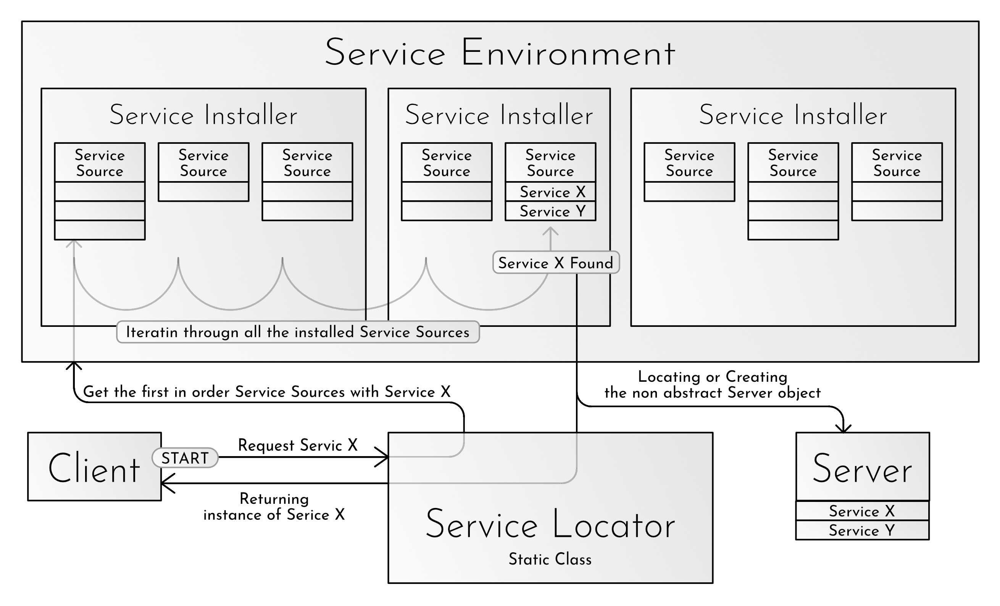
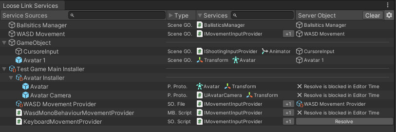
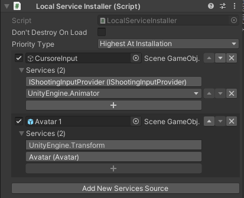
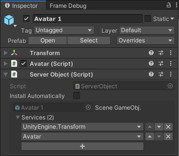
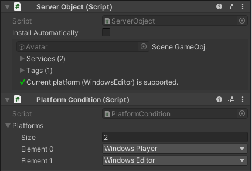

# LooseLink

LooseLink is a Unity-native, type-based service locator designed to resolve (locate or create) unique, high-level, singleton-like services. It is a powerful tool for keeping your codebase clean, testable, flexible, and easy to modify.

## Table of Contents

- [The Problem We Want to Solve](#the-problem-we-want-to-solve)
- [Core Model](#core-model)
- [Service Environment and the Services Window
  ](#service-environment-and-the-services-window)
- [Service Sources](#service-sources)
- [Source Providers](#source-providers)
  - [Project Level Provider: ServiceSourceSet](#project-level-provider-servicesourceset)
  - [Scene Level Provider: LocalServiceInstaller](#scene-level-provider-localserviceinstaller)
  - [GameObject Level Provider: ServerObject](#gameobject-level-provider-serverobject)
- [Resolution Order](#resolution-order)
- [Requesting Services](#requesting-services)
- [Exposing Service Types](#exposing-service-types)
- [Lazy Creation and Circular Dependencies](#lazy-creation-and-circular-dependencies)
- [Source Conditions and Fallbacks](#source-conditions-and-fallbacks)
- [PermanentProxy: Following Service Replacements](#permanentproxy-following-service-replacements)
- [Runtime Environment Changes](#runtime-environment-changes)
- [Global LooseLink Settings](#global-looselink-settings)
- [Step-by-Step Guide](#step-by-step-guide)

## The Problem We Want to Solve

Unity classes often contain too much information about other classes and the overall architecture of the software.

A client class usually needs to know most of the following to use a high-level system:

- What is its exact class?
- Is it a component in a scene or a ScriptableObject?
- Does it exist yet, or does it need to be created?
- What is its lifecycle model?
- How should I access it?

This is what it should actually know:

- I need this functionality to do my work.

LooseLink is designed to make this blissful ignorance (the essence of loose coupling) possible and easy.

---

To resolve a service, the client only needs to request it like this:

```csharp
IInputManager input = Services.Get<IInputManager>();
```

The resolved object may come from another scene, a prefab, a ScriptableObject, a reusable configuration asset, or an object that does not exist yet. The service locator's job is to determine those details using a service environment that is easy to configure and monitor in the Editor. The client knows only the bare minimum: that it needs the service.

----

LooseLink is narrower than a general dependency-injection framework. It is only intended for manager-like, high-level objects where only one service is expected to be active for a given role at a time. This is why only type-based resolution is supported. It is not a general search mechanism for enemies, projectiles, UI elements, or collections of similar low-level objects. This limitation is intentional. LooseLink is built to complement a specific blind spot in Unity's toolset, not to replace its entire serialization system.


## Core Model

LooseLink has five principal layers:

- **Service:** An object, or one of its interfaces, exposed through the service locator.
- **Server Object:** A Unity Object (GameObject, MonoBehaviour, or ScriptableObject) that provides one or more services.
- [**ServiceSource**](#service-sources): Describes how to access a Server Object and which Services (types) that object provides.
- [**SourceProvider**](#source-providers): Contains one or more service sources.
- [**ServiceEnvironment:**](#service-environment-and-the-services-window) The global state that tracks the currently installed providers.

One object can provide several service types. For example, one `GameManager` component may be exposed as `IGameManager`, `ISaveManager`, and `GameManager`.

What happens when a client [requests a Service](#requesting-services) from LooseLink?

Resolution searches eligible providers and sources in a fixed [Resolution Order](#resolution-order).  



(A blocked or invalid source is skipped so a lower-priority fallback can be used.)

## Service Environment and the Services Window

The **Loose Link Services window is the central monitoring interface of the Service Environment**. LooseLink deliberately makes the complete service environment visible instead of hiding global resolution rules behind code or scattered Inspector references.

Services are configured through the Inspectors of installers, source sets, and server objects. The window monitors the resulting environment during setup and shows its live state during Play Mode. It displays which providers and sources are currently available, their priority and order, the service types they expose, whether a source is eligible, and the exact object currently cached behind a binding. This makes it possible to answer the most important debugging question directly: **what object would LooseLink resolve for this service right now, and why?**

Open the editor window from:

`Tools > Loose Link Services`



The window displays the active environment in four columns:

| Column | Description |
| --- | --- |
| Service Sources | Installed providers, nested source sets, and leaf sources. |
| Source Type | How the source accesses or creates its object. |
| Services | The classes and interfaces exposed by the source. |
| Server Object | The currently cached object, with controls for explicit resolution or deletion where applicable. |

The window is the primary workflow for:

- Verifying the environment produced by provider and source configuration in the Inspector.
- Inspecting [priority and source order](#resolution-order), overrides, [conditions, and fallback behavior](#source-conditions-and-fallbacks).
- Finding invalid, blocked, missing, or competing bindings before they become difficult runtime bugs.
- Monitoring the live service environment during Play Mode.
- Seeing whether a lazy service remains unresolved and, if not, which object is currently cached.
- Explicitly instantiating a lazy service, clearing cached references, or deleting a created service on demand.

The runtime API does not require the window to remain open. Its purpose is to make LooseLink's otherwise implicit type-based environment easy to observe, understand, and debug throughout development.

## Service Sources

A service source can access a service in several ways:

| Source | Behavior |
| --- | --- |
| Scene GameObject | Returns a compatible component from an existing scene object. |
| Prefab File | Returns a compatible component from the prefab asset itself. |
| Prefab Prototype | Instantiates the prefab lazily and returns a component from the new instance. |
| ScriptableObject File | Returns the existing ScriptableObject asset. |
| ScriptableObject Prototype | Clones the asset lazily and returns the clone. |
| MonoBehaviour Type | Creates a GameObject and adds the configured MonoBehaviour type lazily. |
| ScriptableObject Type | Creates an instance of the configured ScriptableObject type lazily. |
| [ServiceSourceSet](#source-providers) | Expands a reusable, nested collection of other sources. |

When a source creates an object, it caches the object and reuses it while it remains alive.

If a cached Unity service is destroyed without notifying LooseLink, the source detects the missing object during the next resolution attempt. A source configured to create its service can then create and cache a replacement and mark the environment as changed.

(LooseLink does not own service instances. It is responsible only for providing an object of the requested type at the time of the request.)

## Source Providers

LooseLink supports three provider forms.   
They exist at different levels of the game's lifecycle.

### Project Level Provider: **ServiceSourceSet**  
A reusable ScriptableObject containing service configuration. A set can be nested inside an installer or another set.
Enable the **Use as Global Installer** setting on the ServiceSourceSet to load it automatically.  
Global sets must be stored inside a `Resources` folder so they are discoverable in both the Editor and player builds.

A source set can also be installed or uninstalled explicitly at runtime:

```csharp
Services.Environment.TryInstallServiceSourceSet(sourceSet);
Services.Environment.TryUninstallServiceSourceSet(sourceSet);
```

### Scene Level Provider: **LocalServiceInstaller**    
A scene component containing multiple service sources.   
Its sources are eligible while the installer is installed, active, and enabled.

Lazily created GameObjects are parented under the component installer that provides them. When an asset provider such as a global `ServiceSourceSet` creates a GameObject, it is parented under LooseLink's persistent `Services` GameObject instead. Automatic component installers also provide a **Don't Destroy On Load** option when the installer and its created children should survive scene changes.



### GameObject Level Provider: **ServerObject**  
A component that exposes services from its own GameObject.   
Enable **Install Automatically** when the object should register itself.  
If **Install Automatically** is not enabled, `ServerObject` can still be used to configure the ServiceSource type and the exposed services directly on the GameObject. In this case, use a `LocalServiceInstaller` to add the object to the ServiceEnvironment.



## Resolution Order

Providers are sorted by a priority value.  
Providers with higher priority values are searched first.

Local installers support two types of priorities:

- A fixed priority value.
- **Highest At Installation**, which assigns a value above the current maximum when installed.

Competing bindings at the same provider priority are reported as configuration warnings.
Assign distinct priorities when precedence between providers matters.

Sources inside one provider are searched in their serialized list order. Their order can be changed in the source provider's Inspector.

## Requesting Services

The generic API is normally the clearest option:

```csharp
IInputManager input = Services.Get<IInputManager>();
```

Runtime type lookup is also supported:

```csharp
object input = Services.Get(typeof(IInputManager));
```

Use `TryGet` when a missing service is an expected result:

```csharp
if (Services.TryGet(out IInputManager input))
{
	input.ReadInput();
}
```

The non-generic overload supports types selected at runtime:

```csharp
if (Services.TryGet(typeof(IInputManager), out object service))
{
	IInputManager input = (IInputManager)service;
	input.ReadInput();
}
```

`Services.Get` applies the configured [missing-service policy](#global-looselink-settings) when resolution fails. The available policies are:

- Return `null`.
- Return `null` and log a warning.
- Throw an exception.

## Exposing Service Types

Mark a class or interface with the `[ServiceType]` attribute to make it discoverable automatically:

```csharp
[ServiceType]
public interface IInputManager
{
	void ReadInput();
}
```

Other classes and interfaces can be exposed explicitly through the Inspector.


## Lazy Creation and Circular Dependencies

If a Server Object is instantiated lazily when first requested, circular dependency resolution from `Awake()` or `OnEnable()` is not safe:

```text
Foo() → Get<A>()     // Creates A...
A.Awake() → Get<B>() // Creates B...
B.Awake() → Get<A>() // A already exists, but it cannot be returned because it has not been cached yet.
```

(Unity invokes `Awake()` and `OnEnable()` synchronously during `Instantiate`, `AddComponent`, and `CreateInstance`. This is why LooseLink cannot cache the new object until that Unity construction call returns.)

LooseLink detects the second request for A, fails that lookup, and logs the construction chain with advice to use [`IInitializable`](#the-iinitializable-interface).

### The IInitializable Interface

Use `IInitializable` when lazily created services need post-creation setup or may depend on one another:

```csharp
public sealed class GameplayManager : MonoBehaviour, IInitializable
{
	IInputManager _input;

	public void Initialize()
	{
		_input = Services.Get<IInputManager>();
	}
}
```

LooseLink marks the object as initialized before invoking callbacks, so circular resolution through `Initialize()` is safe. The initialization pass runs once per cached server object. For a created GameObject, LooseLink invokes every `IInitializable` component on that GameObject; for a created ScriptableObject, it invokes the ScriptableObject itself when it implements the interface.

## Source Conditions and Fallbacks

A source can have one or more conditions. A component or ScriptableObject associated with the source defines a condition by implementing `IServiceSourceCondition`. LooseLink considers the source eligible only when every condition returns `true` from `CanResolve()`. `GetConditionMessage()` explains the current result in the Editor.

LooseLink includes a `PlatformCondition` component for GameObject-based sources. Add it to the source GameObject and select the supported `RuntimePlatform` values in the Inspector. The source is skipped when the current platform is not selected; an empty platform list makes it unavailable everywhere.



Custom conditions use the same interface:

```csharp
public sealed class OnlineCondition : MonoBehaviour, IServiceSourceCondition
{
	public bool CanResolve() =>
		Application.internetReachability != NetworkReachability.NotReachable;

	public string GetConditionMessage() =>
		"Available only while the application is online.";
}
```

When `CanResolve()` returns `false`, LooseLink skips that source and continues searching. This supports configurations such as:

1. Windows input manager.
2. Mobile input manager.
3. Default fallback input manager.

Ordinary `Services.Get` calls evaluate conditions during each resolution. When a runtime condition changes, notify LooseLink so [permanent proxies](#permanentproxy-following-service-replacements) know their cached binding may be stale:

```csharp
public void SetOnline(bool isOnline)
{
	if (_isOnline == isOnline)
		return;

	_isOnline = isOnline;
	Services.NotifyEnvironmentChanged();
}
```

## PermanentProxy: Following Service Replacements

An ordinary lookup returns the service active at that moment:

```csharp
IInputManager input = Services.Get<IInputManager>();
```

Use a permanent proxy when a client needs to follow later replacements:

```csharp
PermanentProxy<IInputManager> input = Services.GetProxy<IInputManager>();

input.BindingChanged += (previous, current) =>
{
	// Detach from the previous service and configure the new service.
};

input.Target.ReadInput();
```

Permanent proxies are lazy. [Environment mutations](#runtime-environment-changes) only advance a revision number. A proxy reevaluates its binding the next time `Target` or `TryGetTarget` is accessed, and `BindingChanged` is invoked during that access only when the newly resolved object differs from the cached object.

The proxy members have deliberately different side-effect guarantees:

| Member | Behavior |
| --- | --- |
| `HasTarget` | Checks only the current cached binding. It never resolves or creates a service. It returns `false` when the environment revision is stale. |
| `TryGetTarget(out T target)` | May resolve or create the current service. Returns `false` when no service is available. |
| `Target` | Resolves when necessary and applies the configured missing-service policy on failure. |
| `BindingChanged` | Fires lazily during `Target` or `TryGetTarget` access when the effective target changed. |

`Services.GetProxy<T>()` returns a shared proxy for that service type. Event subscriptions therefore strongly retain their subscribers. Unity clients should unsubscribe in `OnDisable()` or `OnDestroy()`.

## Runtime Environment Changes

The environment revision changes when, for example:

- A provider is installed or uninstalled.
- An installer is enabled or disabled.
- A source is enabled, disabled, reordered, or reconfigured.
- Provider priority changes.
- Client code calls `Services.NotifyEnvironmentChanged()`.
- A lazily created service is created or explicitly destroyed.

LooseLink does not publish an eager environment-wide change event. Clients that care about replacements use [`PermanentProxy<T>`](#permanentproxy-following-service-replacements) and observe changes on their next proxy access.

## Global LooseLink Settings

The settings button in the [Loose Link Services window](#loose-link-services-window) can create a `ServiceLocationSetupData` asset. Store exactly one setup asset in a `Resources` folder.

The setup asset controls when LooseLink initializes. Initialization creates a small database used to improve runtime performance and has a one-time cost per session. Initializing at startup pays that cost before normal gameplay; lazy initialization defers it until the first use of `Services`, where it may cause a small one-time hitch.

The available settings are:

- Whether LooseLink initializes at Play Mode start in the Editor.
- Whether LooseLink initializes before the first scene in a player build.
- The action taken when `Services.Get` cannot resolve a service.

Without a setup asset, LooseLink uses a default configuration:

- **Initialize at Play Mode start in the Editor:** disabled. LooseLink initializes lazily when `Services` is first used.
- **Initialize at startup in a player build:** enabled. LooseLink initializes before the first scene loads.
- **When a service cannot be resolved:** return `null` and log a warning.

## Step-by-Step Guide

This walkthrough creates an audio-manager service from a prefab when it is first requested.

### 1. Define the Service

Create the interface that clients will depend on and mark it as a service type:

```csharp
using LooseLink;

[ServiceType]
public interface IAudioManager
{
	void Play(string soundId);
}
```

Without the [ServiceType] interface you can set up the service on it's Source Provider's Editor Window manually.

### 2. Implement the Service

Create a MonoBehaviour that implements the interface:

```csharp
using UnityEngine;

public sealed class AudioManager : MonoBehaviour, IAudioManager
{
	public void Play(string soundId)
	{
		// Play the requested sound.
	}
}
```

Add `AudioManager` to a GameObject and save that GameObject as a prefab.

### 3. Add an Installer

Create or select a GameObject in the scene and add a [`LocalServiceInstaller`](#source-providers) component. This installer makes its configured sources available while its GameObject is active and enabled.

Enable **Don't Destroy On Load** if the installer and the services created under it should survive scene changes.

### 4. Add the Prefab as a Source

In the `LocalServiceInstaller` Inspector:

1. Click **Add New Services Source**.
2. Drag the audio-manager prefab into the source object field.
3. Select **Prefab Prototype** as the source type.
4. Expand **Services** and verify that `IAudioManager` is listed.

If the `IAudioManager` has `[ServiceType]` and the prefab component implements it, LooseLink exposes the interface automatically. Use the add-service control when another compatible type needs to be exposed explicitly.

### 5. Verify the Environment

Open [`Tools > Loose Link Services`](#loose-link-services-window). The installer, prefab source, source type, and `IAudioManager` binding should appear in the environment.

Before the first request, the Server Object column shows that the lazy service has not been instantiated. During Play Mode, the window shows the created object after resolution.

### 6. Request the Service

Resolve the interface from a client:

```csharp
using LooseLink;
using UnityEngine;

public sealed class MenuSounds : MonoBehaviour
{
	IAudioManager _audio;

	void Awake()
	{
		_audio = Services.Get<IAudioManager>();
	}

	public void PlayConfirmSound()
	{
		_audio.Play("Confirm");
	}
}
```

The first request instantiates the prefab, caches its GameObject, and returns its `IAudioManager` component. Later requests reuse the same cached object while it remains alive.

### 7. Add Initialization When Needed

If the created service needs to resolve other services after Unity construction, implement [`IInitializable`](#the-iinitializable-interface) and perform that setup in `Initialize()`. Use this instead of `Awake()` or `OnEnable()` when lazy services may have circular dependencies.

### Common Variations

- To expose an object that already exists in the scene, add its GameObject as a source and use **Scene GameObject**.
- To return a prefab component or ScriptableObject asset without cloning it, use the corresponding **File** source type.
- To reuse a group of sources, create a [`ServiceSourceSet`](#source-providers) and add that set to an installer or another set.
- To make a source set globally available, place it in a `Resources` folder and enable **Use as Global Installer**.
- To provide fallbacks, add multiple eligible sources and control precedence through [provider priority and source order](#resolution-order), and [source conditions](#source-conditions-and-fallbacks).
- To [follow service replacements](#permanentproxy-following-service-replacements), use `Services.GetProxy<T>()` instead of retaining the result of a single `Services.Get<T>()` call.
